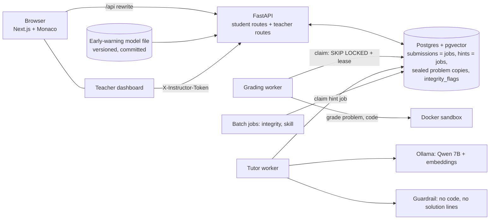
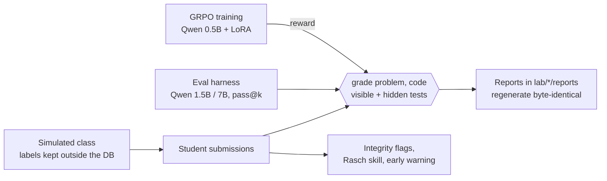

# CodeTutor

[](https://github.com/najeeb101/codetutor/actions/workflows/ci.yml)

A CS1 (intro to programming) Python practice platform with instant auto-grading, and an AI lab
built on top of it. Every problem has automatic visible and hidden tests. The same grader scores
student submissions, evaluates AI models (pass rates), and serves as the reward function for
reinforcement-learning training of a small code model.

**Status:** all 8 weeks are done. The numbers below come from reports that regenerate from the
repository; each one has its caveat next to it.

## Results at a glance

| Part | Headline result | Caveat | Report |
|---|---|---|---|
| Problem bank + grader | 33 problems, 374 tests (242 hidden), 97 known-wrong solutions; the validator checks that each one fails a test | The default sandbox is not secure; Docker is required for strangers' code | [docs/grader.md](docs/grader.md) |
| Model evals | Qwen2.5-Coder 1.5B pass@1 0.867 [0.779, 0.942]; 7B (4-bit) 0.945 [0.867, 1.000]; 330 answers each | Intervals resample problems only; one prompt, one temperature | [week2.md](lab/evals/reports/week2.md) |
| AI tutor | Hybrid note search finds the right section in the top 3 for 40 of 40 questions (keyword 34); the guardrail blocks 3% / 10% of first hints (levels 1 / 2) | 40 questions written by the same author as the notes | [retrieval](lab/tutor/reports/retrieval.md), [safety](lab/tutor/reports/tutor_safety.md) |
| Do hints help? | Teacher hint 1: +0.09 [+0.03, +0.15] more fixes; the tutor's hint 1: +0.04 [−0.02, +0.11] | **Not shown to help**: the tutor's intervals include 0; the student is a 1.5B model | [tutor_eval.md](lab/tutor/reports/tutor_eval.md) |
| Integrity flags | Held-out class: precision 0.64 [0.32, 0.99], recall 0.86 [0.74, 0.97] | A simulated class with 8 cheating students; 76 of 79 false flags are honest students pasting from their own editor | [integrity.md](lab/integrity/reports/integrity.md) |
| Difficulty + skill | Rasch difficulty r 0.89 vs 0.88 for plain pass rates | Barely better; the simulator itself follows the Rasch model | [skill.md](lab/skill/reports/skill.md) |
| GRPO on the grader | Held-out change **+0.02 [0.00, +0.04]** against a noise band of ±0.032 | **Within noise**: no claim that training transfers; the run is repeatable (2 seeds agree) | [pooled.md](lab/rl/reports/pooled.md), [seeds.md](lab/rl/reports/seeds.md) |
| Early warning | AUC 0.94 [0.86, 0.99] on the held-out class | **Not shown to beat** the one-line rule "low first-try share" (0.92); simulated students | [early_warning.md](lab/early/reports/early_warning.md) |

Everything marked simulated has not been tried on real students.

## What is in it

| | |
|---|---|
| Problems | 33, in 8 CS1 modules (variables → recursion): 17 easy, 15 medium, 1 hard |
| Tests | 374, of which 242 are hidden |
| Buggy solutions | 97 known-wrong solutions; every problem has at least one bug that only hidden tests catch |
| Test suite | 863 pytest tests, plus 36 that run in Docker and 1 slow one (the whole-bank check that `make validate` also runs); 31 test submissions, most of them hostile (infinite loops, memory bombs, `os._exit`, fake results, output floods, reading host files) |
| Model evals | 2 official runs (Qwen2.5-Coder 1.5B and 7B), 330 graded answers each |
| App | Postgres (8 tables), a grading queue in Postgres, a FastAPI service (11 student endpoints + 4 teacher endpoints), a Next.js UI with the Monaco editor and an instructor dashboard; checked end to end over HTTP and in a headless browser |
| AI tutor | Qwen2.5-Coder 7B (local, Ollama), hybrid search over 8 course notes (41 sections, pgvector), a guardrail against code and solution lines, a hint queue + worker, 👍/👎; measured: a safety run (97 buggy files) and an offline eval (54 situations × 6 conditions × 5 answers) |
| Simulated class | 2 classes of 60 students (seed 0: 3,145 submissions, seed 1: 3,076), each graded by the real workers in its own database; every row has a label (honest, copy, AI paste, how it was entered) that is kept out of the database |
| RL training | GRPO with LoRA on Qwen2.5-Coder 0.5B, reward = the grader's share of tests passed (hidden tests included); 4 module folds + a second seed, 5 trained adapters, each measured on 30 answers per problem |
| Instructor dashboard | Teacher token, class overview, students (skill, early-warning risk, marks to look at), problems (declared vs measured difficulty); no code is ever shown |
| Integrity + skill | 4 signals (paste, fast typing, same as another student, same as a known AI answer), thresholds chosen on seed 0 and measured on seed 1; Rasch difficulty and skill estimates scored against the simulation's true values |

A validator checks every problem: the reference solution passes all tests, the starter code does
not, and every buggy solution fails at least one test (a simple form of mutation testing).

## Where the code is

Python code lives in [`src/codetutor/`](src/codetutor/) (the usual "src layout"). The top-level
`api/` and `tutor/` folders only hold a README that points there.

| Part | Folder |
|---|---|
| Grader: runner, sandboxes (subprocess, Docker), comparison | [src/codetutor/grader/](src/codetutor/grader/) |
| Problem format + loader; the 33 problems | [src/codetutor/problems/](src/codetutor/problems/), [problems/cs1/](problems/cs1/) |
| HTTP API (FastAPI) | [src/codetutor/api/](src/codetutor/api/) |
| Grading queue in Postgres + worker | [src/codetutor/worker/](src/codetutor/worker/), [src/codetutor/db/](src/codetutor/db/) |
| AI tutor: guardrail, search, prompt, hint worker | [src/codetutor/tutor/](src/codetutor/tutor/) |
| Model evals (pass@k) | [src/codetutor/evals/](src/codetutor/evals/) |
| GRPO training with the grader as reward | [src/codetutor/rl/](src/codetutor/rl/) |
| Simulated class, integrity checks, skill, early warning | [sim/](src/codetutor/sim/), [integrity/](src/codetutor/integrity/), [skill/](src/codetutor/skill/), [early/](src/codetutor/early/) |
| Web UI (Next.js + Monaco) | [web/](web/) |
| Containers and CI | [deploy/](deploy/), [compose.prod.yaml](compose.prod.yaml), [.github/workflows/ci.yml](.github/workflows/ci.yml) |
| Tests (incl. hostile submissions) | [tests/](tests/) |

## How grading works

- **One function for everything:** `grade(problem, code) -> GradeResult`. Student submissions,
  model evals and the RL reward all use it, so they can never disagree.
- **The student's code never sees the answers.** It runs in a child process that gets the test
  *inputs* only. The parent process compares the results with the expected values.
- **Visible and hidden tests.** Students see the visible ones. Hidden tests catch solutions that
  only fit the examples. The reward is partial credit: passed tests / all tests.
- **Limits:** time per test, total time and memory. The possible statuses are `accepted`, `wrong_answer`,
  `runtime_error`, `timeout`, `compile_error` and `crashed`.
- **Reproducible:** grading is deterministic (apart from timeouts on a very busy machine), and
  every result records the grader version and the problem version.

Details: [docs/grader.md](docs/grader.md). Problem format: [docs/problem-format.md](docs/problem-format.md).

## Requirements
- Linux or macOS (on Windows, use WSL2); the grader's sandbox uses POSIX features
- Python 3.11+
- [uv](https://docs.astral.sh/uv/)
- Docker with Compose (for the local database and the safe sandbox)
- Node 24 (for the web UI only; installed with [nvm](https://github.com/nvm-sh/nvm))
- [Ollama](https://ollama.com) (for model evals and the tutor only), with `qwen2.5-coder:7b`,
  `qwen2.5-coder:1.5b-instruct-fp16` and `nomic-embed-text`

> **⚠️ Security:** the default sandbox is a subprocess with resource limits. It is **not secure**:
> graded code can read your files and use the network. For code you don't trust, use the Docker
> sandbox (`--sandbox docker`, or `DockerSandbox()` in Python): no network, no host files,
> non-root, a process limit. It is much safer, but not a perfect wall (containers share the
> host's kernel). See [docs/grader.md](docs/grader.md#5-threat-model), sections 5 and 6.

## Install and check
```bash
make install    # install dependencies and the package (editable)
make db-up      # start the local Postgres (compose.yaml, 127.0.0.1 only); make db-down stops it
make db-sync    # create the tables (migrations) and copy the problems into Postgres
make all        # lint + tests + validate every problem (starts the database if needed)
make build      # write dist/problems.jsonl and dist/problems_student.jsonl
```
Other targets: `make test`, `make lint`, `make validate`, `make format`, and
`make test-docker` (runs the hostile submissions in the Docker sandbox; needs Docker),
`make e2e` / `make web-e2e` (checks of the running stack), `make sim` / `make integrity` /
`make skill` / `make early` (the simulated class and its reports), `make api-sim` (the API on the
simulated class, for the dashboard) and `make web-check` (type check + production build).
CI ([.github/workflows/ci.yml](.github/workflows/ci.yml)) runs `make all`, `make test-docker` and
`make web-check` on every push. Before pushing, run `uv run python scripts/check_secrets.py
--history` (it looks for secrets in every commit, not only the staged changes).

## Grade a solution
From the command line. This file checks `% 3` before `% 15`, a classic fizzbuzz bug:
```bash
uv run python scripts/grade_cli.py cs1.loops.fizzbuzz problems/cs1/03_loops/fizzbuzz/buggy/checks_fizz_first.py
```
```text
Problem: cs1.loops.fizzbuzz (version 1)
Status:  wrong_answer
Reward:  0.6  (6/10 tests passed)

      test  kind     result         details
  ✅  t01   visible  passed
  ✅  t02   visible  passed
  ✅  t03   visible  passed
  ✅  t04   visible  passed
  ❌  t05   hidden   wrong_answer   (hidden test)
  ❌  t06   hidden   wrong_answer   (hidden test)
  ✅  t07   hidden   passed
  ✅  t08   hidden   passed
  ❌  t09   hidden   wrong_answer   (hidden test)
  ❌  t10   hidden   wrong_answer   (hidden test)
```
Every visible test passes; only the hidden tests (multiples of 15) find the bug. Add
`--reveal-hidden` to see their inputs, `--json` for the full `GradeResult`, or `--sandbox docker`
to run the code in a container.

From Python:
```python
from pathlib import Path

from codetutor.grader import grade
from codetutor.problems import get_problem

problem = get_problem("cs1.loops.fizzbuzz")
code = Path("problems/cs1/03_loops/fizzbuzz/solution.py").read_text()
result = grade(problem, code)
print(result.status, result.reward, f"{result.passed}/{result.total}")
```
```text
accepted 1.0 10/10
```

## Evaluate a model
The eval harness gives a model the same view a student gets (description, starter code, visible
tests), takes the code out of its reply, and grades it with the same `grade()`. Official results
(10 answers per problem, temperature 0.8, seeds 0–9, graded in the Docker sandbox, on a laptop
GPU):

| Model | pass@1 [95% interval] | pass@10 | Mean reward | Wrong answers that pass every visible test |
|---|---|---|---|---|
| Qwen2.5-Coder 1.5B (fp16) | 0.867 [0.779, 0.942] | 1.000 | 0.953 | 15 of 44 |
| Qwen2.5-Coder 7B (4-bit) | 0.945 [0.867, 1.000] | 1.000 | 0.989 | 9 of 18 |

Both models solve every problem at least once in 10 tries, but not every time. A third (1.5B)
and a half (7B) of their wrong answers pass every visible test: only the hidden tests catch
them. Note that the two runs differ in size *and* precision (the 7B is 4-bit). Full report, by
module, difficulty and concept: [lab/evals/reports/week2.md](lab/evals/reports/week2.md).

```bash
# Rebuild the report from the committed results (no model needed)
uv run python scripts/eval_report.py lab/evals/results/*.jsonl --out lab/evals/reports/week2.md

# Ask a local model to solve one problem (needs Ollama; grading uses Docker)
ollama pull qwen2.5-coder:1.5b-instruct-fp16   # from WSL, with Ollama on Windows: ollama.exe pull ...
uv run python scripts/try_model.py ollama/qwen2.5-coder:1.5b-instruct-fp16 cs1.loops.fizzbuzz

# A small test run: 2 problems x 2 answers, written to lab/evals/scratch/ (gitignored)
uv run python scripts/run_eval.py lab/evals/configs/qwen2.5-coder-1.5b-fp16.yaml \
    --problems cs1.loops.fizzbuzz,cs1.strings.compress --samples 2
```
A full run (33 problems × 10 answers) takes about 15 minutes on an RTX 4060 laptop GPU. Runs are
resumable, and a failed API call is retried, never graded as a wrong answer. Gemini (client only, no official run) needs an API
key in `.env` (run with `uv run --env-file .env ...`). Setup, the model client and the report:
[docs/evals.md](docs/evals.md).

## Run the app
Four terminals, started one after the other (each one syncs the problems into Postgres first):
```bash
make worker   # grades queued submissions in the Docker sandbox
make tutor    # answers hint requests with the local Qwen 7B (needs Ollama, see "Evaluate a model")
make api      # the HTTP API on http://127.0.0.1:8000 (interactive docs at /docs)
make web      # the web UI on http://localhost:3100 (installs its npm packages the first time)
```
Open http://localhost:3100, log in with any name (a development login: **not secure**), pick a
problem, write code, submit, and ask the tutor for a hint ("Stuck? Ask the tutor"). Then check
the whole chain:
```bash
make e2e      # 11 checks over HTTP: API, workers, web pages, hidden tests stay hidden, a hint (~19 s)
make web-e2e  # 9 checks in headless Chrome: log in, submit, results, a hint + 👍, limits, drafts (~27 s)
```
The teacher dashboard is at http://localhost:3100/instructor. It needs a token the API was
started with (`INSTRUCTOR_TOKEN`, 16+ characters), and it is most interesting on the simulated
class (`make sim` once, ~13 min). Port 8000 or 3100 may be taken on your machine; this uses 8010:
```bash
INSTRUCTOR_TOKEN=$(openssl rand -hex 16) API_PORT=8010 make api-sim
CODETUTOR_API_URL=http://127.0.0.1:8010 make web   # then open /instructor and paste the token
```
It shows the class (with an early-warning risk column, see below): see [docs/api.md](docs/api.md) §8. Its browser checks:
`INSTRUCTOR_TOKEN=... E2E_ONLY=instructor node web/scripts/e2e.mjs`.
`make web-e2e` starts its own Chrome (in WSL, the Windows Chrome; `CHROME=/path` picks
another one). Without the UI, `scripts/submit.py` sends a file to the queue:
`uv run python scripts/submit.py cs1.loops.fizzbuzz problems/cs1/03_loops/fizzbuzz/solution.py --wait`.
How it works: [docs/worker.md](docs/worker.md) (queue), [docs/api.md](docs/api.md) (API),
[docs/tutor.md](docs/tutor.md) (the tutor), [web/README.md](web/README.md) (UI).

### Run it in containers
The same app from Docker images (the way it will run on a server; [docs/deploy.md](docs/deploy.md)):
```bash
cp .env.prod.example .env.prod   # fill in the three values: openssl rand -hex 24
make prod-build                  # 3 images: app, web, grading sandbox (~2.5 min the first time)
make prod-up                     # web on http://127.0.0.1:3200, API on 127.0.0.1:8010
make prod-e2e                    # 9 end-to-end checks (the tutor is not containerized yet)
make prod-down
```
Guest sessions, a database role without the hidden tests and site-wide limits are in; the web UI's guest button and HTTPS are next (docs/deploy.md §5).

### Architecture (as built)
The product: a student's submit is one row in Postgres, which is also the job.

The lab: one `grade()` function serves every purpose, so the number a student sees, the number
an eval reports and the reward in training can never disagree.

The browser polls `GET /api/submissions/{id}` (and `GET /api/hints/{id}`) once per second until
the job is done. There is no Redis: Postgres is the queue, so saving a request and queueing it
can never disagree. Only the two workers read the sealed problem copies; the API never does.

## The AI tutor
A student who is stuck asks for a hint (level 1, then 2; level 3 is the teacher's last hint).
The tutor worker finds the 3 best course-note sections for the problem and the student's code
(keyword + vector search, merged), and asks the local Qwen 7B for a short hint. The model sees
the problem, the teacher's hints up to that level, the student's code and their visible results,
never the solution or the hidden tests. Three layers keep answers out:
1. the prompt: "no code", and the student's text is marked as data (against prompt injection);
2. the **guardrail** (`tutor/guardrail.py`): blocks code blocks, code statements, and any line
   of the reference solution, with one retry;
3. a **fallback**: if both tries are blocked, the student gets the teacher's hint instead.

Every attempt, blocked ones too, is saved as a row in Postgres (the trace); only the shown text
leaves the server. Measured (details in [docs/tutor.md](docs/tutor.md)):

| What | Result |
|---|---|
| Guardrail on the bank's own hints 1–2 / on 298 generated leaks | 0 of 66 blocked / 298 of 298 blocked |
| Note search, 40 labelled questions (recall@3) | keyword 34/40, vector 39/40, hybrid 40/40 |
| Safety run, 97 buggy files: 7B first try blocked (level 1 / 2) | 3% / 10% (teacher's hint shown 3% / 1%) |
| Offline eval: does a hint help a 1.5B "student" fix a hidden-only bug? | below |

| Condition (54 situations × 5 answers) | Fix rate | Help vs no hint [95%] |
|---|---|---|
| No hint | 0.58 | – |
| Teacher's hint 1 | 0.66 | +0.09 [+0.03, +0.15] |
| Tutor's hint 1 | 0.62 | +0.04 [−0.02, +0.11] |
| Tutor's hint 2 | 0.63 | +0.06 [−0.03, +0.15] |
| Teacher's hint 3 (bottom-out) | 0.70 | +0.12 [+0.04, +0.21] |

Honest reading: the tutor's hints help a little on average, but with this much data we can't
tell that from no help; hints can also hurt (a hint with the wrong diagnosis took one situation
from 0.80 to 0.00). The student is a small model, not a person. Full report:
[lab/tutor/reports/tutor_eval.md](lab/tutor/reports/tutor_eval.md).

```bash
# One hint about a buggy file, with its trace (needs Ollama + the database; grading uses Docker)
uv run python scripts/ask_tutor.py cs1.loops.fizzbuzz \
    problems/cs1/03_loops/fizzbuzz/buggy/checks_fizz_first.py --no-save

# Rebuild the tutor eval report from the committed results (no model needed)
uv run python scripts/tutor_eval.py --report-only

# A small test run of the tutor eval: 1 problem, written to lab/tutor/scratch/ (~1.5 min)
uv run python scripts/tutor_eval.py --limit 1

# Measure the note search again (needs `make notes-sync`)
uv run python scripts/eval_retrieval.py
```
The full tutor eval (1,620 answers) took 63 minutes on the laptop GPU and can be stopped and
resumed. Tracing uses our own Postgres table, not Langfuse (a change from the original plan:
the table already holds the whole trace, and no hint data leaves the machine).

## Simulated students, integrity and skill
Real students are not available, so Week 5 simulates a class whose behaviour we **know**: 60
students (strong, average, struggling, quitters, 4 copiers, 4 AI users), their true skills, and
which submissions are cheating and how they were entered (pasted, retyped, or honest code pasted
from the student's own editor). No model is called: the code comes from the bank's solutions and
buggy files, the Week 2 and Week 4 model answers, and programmatic disguises (renamed variables,
reformatting). The class goes through the same door as a real submit and is graded by the real
Docker workers; the labels stay in `lab/sim/` and never enter the database.

**Integrity checks** (a batch job; flags are for a teacher, never a punishment): two signals for
how the code got in (one big paste; typing faster than a person thinks) and two for what it is
(the same structure as another student's earlier code, or as a known AI answer; names and layout
are ignored). A submission **needs review** when it has one of each. Thresholds were chosen on
class seed 0 and measured once on held-out class seed 1:

| Held-out class (seed 1) | Result |
|---|---|
| Needs review: precision | 0.64 [0.32, 0.99] |
| Needs review: recall | 0.86 [0.74, 0.97] |
| Cheating students with at least one flag / honest students with a false flag | 8 of 8 / 5 of 52 |
| Each signal alone: precision | paste 0.51, fast typing 0.93, same as student 0.06, same as AI 0.16 |

Honest reading: the intervals resample students (one copier makes many similar rows), and they
are wide because 76 of the 79 false flags are honest students who paste whole programs from their
own editor. Thresholds can't fix that; only new evidence could. The simulator also chose how
cheaters behave (for example, retypers type fast), so these are the numbers for *our* cheaters.

**Difficulty and skill** from each student's first try at each problem, by counting and by a
Rasch model (the chance of a first-try solve is a function of skill minus difficulty), scored
against the simulation's true values: difficulty r 0.84 / 0.89 and skill r 0.91 / 0.86 (seeds 0 /
1). Rasch is only slightly better than counting here (by 0.01 to 0.04 even with answers missing),
because almost every simulated student tried almost every problem.

```bash
# The integrity checks on both graded classes, then the held-out report (needs `make db-up`
# and the graded classes: `make sim`, then `SIM_SEED=1 make sim`, ~13 min each, Docker)
make integrity       # ~15 s; writes lab/integrity/reports/integrity.md (byte-identical)
make skill           # ~25 s; writes lab/skill/reports/skill.md

# The threshold search alone, and the estimates for the development database
uv run python scripts/integrity.py tune --seed 0
uv run python scripts/skill.py show --dev

# Regenerate a simulated class: the rows file is byte-identical every time
uv run python scripts/sim_cohort.py generate --seed 1
```
How it works: [docs/integrity.md](docs/integrity.md). Reports:
[integrity](lab/integrity/reports/integrity.md), [skill](lab/skill/reports/skill.md).

### Early warning (Week 8)
A small logistic regression (pure Python) reads only the first three weeks and ranks who will
solve fewer than 40% of their later problems on the first try. Fitted on one simulated class,
scored on the other: AUC 0.94 [0.86, 0.99], 8 of the top 10 really at risk, but a plain
"low first-try share" rule scores 0.92 and also 8 of 10, so the model is **not shown to beat
the simple rule**. It cannot see students who will quit (they look average until they stop).
```bash
make early                                        # writes lab/early/reports/early_warning.md (~15 s)
uv run python scripts/early_warning.py show --dev # top risk scores in the dev database
```
`make early-export` rewrites the model file the dashboard serves
(`src/codetutor/early/model_week3.json`); `make early` refuses to run if it differs from a fresh fit.
How it works: [docs/early-warning.md](docs/early-warning.md). Report:
[early warning](lab/early/reports/early_warning.md).

## Add a problem
1. Create `problems/cs1/<NN>_<module>/<slug>/` with `problem.yaml`, `starter.py`, `solution.py`,
   `tests.yaml` (inputs only) and 1–3 files in `buggy/`.
2. `uv run python scripts/fill_expected.py <folder>` runs the solution to fill in the expected values.
3. `make validate`. A buggy solution that passes every test means a test is missing.
4. When you change the tests of an existing problem, bump its `version`.

Full checklist: [docs/problem-format.md](docs/problem-format.md#6-how-to-add-a-problem).

## Training a small model with the grader as reward
The same `grade()` that marks students is the reward function: the share of tests an answer
passes, hidden tests included. We trained Qwen2.5-Coder 0.5B with GRPO (LoRA, 100 steps × 4
problems × 8 answers, on one RTX 4060). To see whether it learns something that transfers, each
run **hides two whole modules** from training (4 folds, so every problem is hidden once) and is
measured on those. Every model is evaluated on 3 sampling draws (30 answers per problem), because
a first check showed the untrained model itself moves ±0.03 between two draws.

| Held-out problems (pass@1, 30 answers each) | Before | After | Change [95% interval] | Noise band |
|---|---|---|---|---|
| fold a (8) | 0.808 | 0.833 | +0.03 [−0.01, +0.06] | ±0.064 |
| fold b (8) | 0.738 | 0.742 | 0.00 [−0.04, +0.05] | ±0.064 |
| fold c (8) | 0.446 | 0.471 | +0.03 [0.00, +0.05] | ±0.064 |
| fold d (9) | 0.619 | 0.656 | +0.04 [0.00, +0.09] | ±0.060 |
| **all 33, each held out once** | 0.652 | 0.675 | **+0.02 [0.00, +0.04]** | ±0.032 |

Honest reading: the change is positive in all four folds, but it is smaller than the noise band
we wrote down before the runs, so we **do not claim transfer**. It is a small possible effect.
A second training seed on fold c gave +0.03 and +0.04, so the training run is repeatable; that is
not the same as an effect. On the problems it trained on, the model does improve (+0.07 to +0.08
on fold c). A **reward-hacking audit** read every answer that wrote a visible result into its
function: 3.1% for the untrained model and for every adapter, and one real attempt (a fizzbuzz
that wrote out the visible output, and failed the hidden tests) in 4,950 trained-model answers.
Hidden tests are why copying the examples does not pay.

```bash
# Reports from the committed results (no GPU; each is byte-identical every time)
make rl-folds-report     # lab/rl/reports/folds.md: the four folds
make rl-pool-report      # lab/rl/reports/pooled.md: 30 answers per problem, the table above
make rl-seed-report      # lab/rl/reports/seeds.md: fold c, two training seeds
make rl-hacking          # lab/rl/reports/hacking.md: the reward-hacking audit

# Training and evaluating need the GPU and Docker (hours; `make rl-install` is ~5.6 GB)
make rl-install && make rl-env
make rl-train FOLD=c SEED=0     # ~1.5 h; then make rl-after-run RUN=c
```
How it works and every measurement: [docs/rl.md](docs/rl.md). Limits: the 0.5B model, 33
problems, one seed per fold except fold c, and a detector that only sees literals.

## Project layout
- `problems/`: the problem bank (one folder per problem)
- `src/codetutor/problems/`: problem schema and loader
- `src/codetutor/grader/`: runner (child process), sandboxes (subprocess, Docker), comparison, `grade()`
- `src/codetutor/bank/`: expected-value filler, validator, dataset builder
- `src/codetutor/evals/`: prompt, code extraction, pass@k, model client, run harness, metrics, report
- `src/codetutor/db/`: database tables (SQLAlchemy), Alembic migrations, problem sync
- `src/codetutor/worker/`: the grading queue in Postgres (claim, lease, retries) and the worker loop
- `src/codetutor/api/`: the HTTP API (FastAPI): endpoints, dev login, rate limits, hint requests, the instructor routes (`instructor.py`)
- `src/codetutor/tutor/`: the AI tutor: guardrail, course-note search, prompt, `give_hint`, the hint queue and worker
- `src/codetutor/sim/`: the simulated class: personas, code pools, disguises, editor summaries, loading
- `src/codetutor/integrity/`: the four integrity signals, rename-proof comparison, threshold search, report
- `src/codetutor/skill/`: first-attempt responses, Rasch fit, pass-rate baselines, scoring, report
- `src/codetutor/early/`: early warning: features up to a cutoff week, logistic regression, AUC and top-10 metrics, report
- `src/codetutor/rl/`: RL prompt folds, the reward, GRPO training (TRL + LoRA), the before/after, noise, pooled and seed reports, the reward-hacking audit
- `course/notes/`: the course notes the tutor searches
- `src/codetutor/e2e.py`: end-to-end checks of a running stack (`make e2e`)
- `web/`: the web UI (Next.js + Monaco), with its own README
- `scripts/`: command-line wrappers for the above, plus the grading and eval CLIs
- `lab/evals/`: run configs, committed results (one graded answer per line) and the report
- `lab/tutor/`: the retrieval questions, the tutor's safety-run and eval results, and their reports
- `lab/rl/`: the folds, trained adapters (config only), training logs and generated RL reports
- `lab/sim/`: the two simulated classes with their labels; `lab/integrity/`, `lab/skill/`, `lab/early/`: generated reports
- `tests/`: test suite; `tests/submissions/` holds the hostile submissions
- `docs/`: design docs (`grader.md`, `problem-format.md`, `evals.md`, `database.md`, `worker.md`, `api.md`, `tutor.md`, `integrity.md`, `rl.md`, `early-warning.md`, `demo-script.md`, and `KICKOFF.md` = the original brief); `docs/notes/` holds weekly notes and interview notes

## Limits and what I'd do next
- Every student-side result (integrity, skill, early warning, hint help) comes from simulated
  students or a small model standing in for one. Real classes, with consent, are the next step.
- GRPO on a 0.5B model gave a small change that is within noise; a bigger model, more steps or a
  better reward (efficiency tests) are the open experiments ([docs/rl.md](docs/rl.md)).
- The dev login and the shared teacher token are not real authentication; real accounts, the
  Docker sandbox for all grading and a request-size limit come before hosting
  ([docs/api.md](docs/api.md) §7-8).
- One test, `test_memory_bomb[subprocess-memory_bomb_growing]`, sometimes fails on a loaded
  machine with little free memory (rerun it alone; see CLAUDE.md, Q14).
- Ideas not built: [docs/ideas.md](docs/ideas.md).

## Roadmap
| Week | Deliverable | |
|---|---|---|
| 1 | Problem bank + grader + validator (+ optional Docker sandbox) | ✅ done |
| 2 | Eval harness: LLMs through the grader, pass@1 / pass@k by module and difficulty | ✅ done |
| 3 | FastAPI + Postgres + job queue + minimal Next.js UI | ✅ done |
| 4 | AI tutor that gives hints, not answers | ✅ done |
| 5 | Simulated students, integrity checks, difficulty estimates | ✅ done |
| 6–7 | GRPO training of a small Qwen model with the grader as reward | ✅ done |
| 8 | Instructor dashboard, early-warning model, final write-up, demo script | ✅ done (the video is recorded by Najeeb) |
